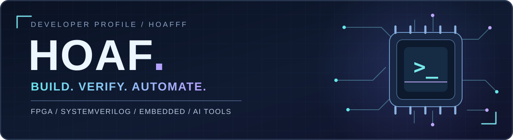
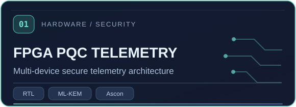
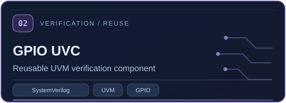
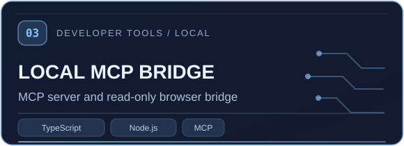
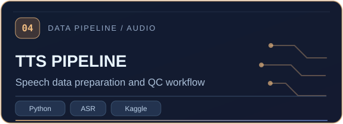

<div align="center">
  

  <a href="https://github.com/hoafff">
    
  </a>

  <p>
    <a href="#featured-projects">Featured Projects</a> ·
    <a href="#toolbox">Toolbox</a> ·
    <a href="#github-activity">GitHub Activity</a>
  </p>
</div>

---

## > whoami

```yaml
name: Hoaf
mindset: "Learn → Build → Test → Improve"
interests:
  - FPGA & digital system design
  - SystemVerilog / UVM verification
  - Embedded systems
  - AI pipelines & developer automation
```

Mình thích học thông qua việc **xây project thật**, tìm hiểu hệ thống hoạt động như thế nào và kiểm chứng những gì mình viết. Các repo bên dưới trải từ RTL/verification, embedded đến công cụ tự động hóa và xử lý dữ liệu.

## Featured Projects

<div align="center">
  <a href="https://github.com/hoafff/fpga-pqc-secure-telemetry"></a>
  <a href="https://github.com/hoafff/UVC_gpio"></a>
  <a href="https://github.com/hoafff/MCP_Chatgpt"></a>
  <a href="https://github.com/hoafff/TTsbyHoaf"></a>
</div>

<sub>Click vào thẻ để xem mã nguồn, kiến trúc và tình trạng thực tế của từng project.</sub>

<details>
<summary><b>Explore more repositories</b></summary>

- **[Counter16 Verification](https://github.com/hoafff/counter16_verification)** — so sánh testbench SystemVerilog class-based và UVM trên cùng một DUT.
- **[FPGA MCU Trinity](https://github.com/hoafff/fpga_mcu_trinity)** — dự án kết hợp FPGA và MCU.
- **[Viterbi](https://github.com/hoafff/Viterbi)** — tìm hiểu thuật toán/giải mã Viterbi.
- **[Embedded Systems](https://github.com/hoafff/He-thong-nhung)** — bài tập và thực hành hệ thống nhúng.

</details>

## Toolbox

**Digital hardware & verification**


**Software, AI & automation**


## How I work

```text
[ IDEA ] ---> [ DESIGN / BUILD ] ---> [ TEST / VERIFY ] ---> [ ITERATE ]
    ^                                                     |
    +-----------------------------------------------------+
```

> **“Làm trước, hoàn thiện sau.”** — nhưng luôn kiểm thử và ghi rõ những gì đã/chưa được xác minh.

## GitHub Activity

<div align="center">
  
  
</div>

<sub>Stats dùng dịch vụ bên ngoài nên đôi khi có thể chậm hoặc tạm thời không hiển thị. Biểu đồ ngôn ngữ phản ánh code trong repo công khai, không phải mức độ thành thạo.</sub>

---

<div align="center">
  <sub>Keep building. Keep learning. Keep shipping useful things.</sub>
  <br />
  <a href="https://github.com/hoafff">github.com/hoafff</a>
</div>
